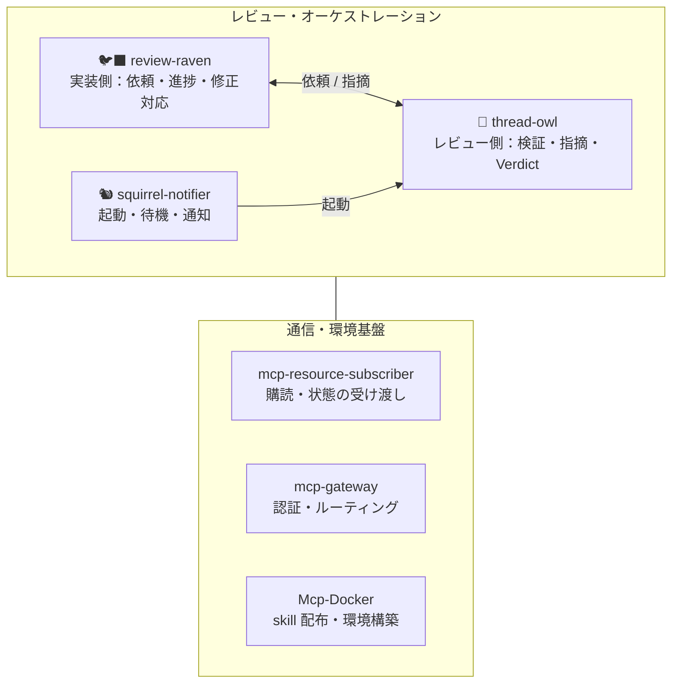

# scottlz0310

AI エージェントと協働する開発のためのツールと MCP サーバーを作っています。
レビュー基盤「Reviewers Forest」を中心に、開発環境ツール、Windows デスクトップアプリ、業務ツールを公開しています。

## 🌲 Reviewers Forest

AI による PR レビューを、依頼する側・レビューする側・オーケストレーション・通信基盤に分けた、6 リポジトリ構成のレビュー基盤です。各リポジトリは独立して保守・更新できます。

| リポジトリ | 役割 |
|---|---|
| [review-raven](https://github.com/scottlz0310/review-raven) | 実装側の窓口。レビュー依頼・再依頼、進捗と完了の取得、指摘への返信・resolve |
| [thread-owl](https://github.com/scottlz0310/thread-owl) | レビュー側。対象の検証とレビュー、指摘・Verdict の投稿 |
| [squirrel-notifier](https://github.com/scottlz0310/squirrel-notifier) | WinUI 3 製の通知ランチャー。MCP イベントを購読し、トーストからエージェントを起動 |
| [mcp-resource-subscriber](https://github.com/scottlz0310/mcp-resource-subscriber) | MCP リソースの購読・read・tool 呼び出しを担う外部クライアント |
| [mcp-gateway](https://github.com/scottlz0310/mcp-gateway) | MCP サーバー群への統合ゲートウェイ（OAuth 認証・ルーティング） |
| [Mcp-Docker](https://github.com/scottlz0310/Mcp-Docker) | Docker で動かす MCP サーバー群と skill の管理・配布 |

## 🛠 開発環境ツール

| リポジトリ | 概要 |
|---|---|
| [dsx](https://github.com/scottlz0310/dsx) | リポジトリ管理・システム更新・Bitwarden 連携を一元化するクロスプラットフォーム CLI（Go） |
| [arbor](https://github.com/scottlz0310/arbor) | 複数のローカル git リポジトリを一元管理するデスクトップアプリ（Tauri v2） |
| [agent-statusline](https://github.com/scottlz0310/agent-statusline) | Claude Code などの CLI エージェント向け高速ステータスライン（Rust） |
| [md-peruse](https://github.com/scottlz0310/md-peruse) | Markdown を閲覧専用プレビューで表示する Windows 用ワークスペースビューワー |
| [renovate-config](https://github.com/scottlz0310/renovate-config) | 全リポジトリ共通の Renovate プリセット |
| [release-automate](https://github.com/scottlz0310/release-automate) | リリース作業を省力化する再利用可能ワークフロー |

## 🗺 写真・地図

| リポジトリ | 概要 |
|---|---|
| [PhotoGeoExplorer](https://github.com/scottlz0310/PhotoGeoExplorer) | 写真の撮影地点を地図で確認する Windows アプリ（Microsoft Store 公開中） |
| [photo-map-studio](https://github.com/scottlz0310/photo-map-studio) | EXIF GPS から撮影地点の地図画像を生成・一括出力（WinUI 3） |

## 🏗 業務ツール

| リポジトリ | 概要 |
|---|---|
| [tacho-graph-studio](https://github.com/scottlz0310/tacho-graph-studio) | タコグラフ画像の前処理・角度補正・自動文字入れ（WinUI 3 / OpenCvSharp） |
| [cloud-migrator](https://github.com/scottlz0310/cloud-migrator) | クラウドストレージ間のファイル一括移行 CLI |

## 📦 その他

- [gmail-manager](https://github.com/scottlz0310/gmail-manager) — Gmail 整理用 Web UI
- [costcalc](https://github.com/scottlz0310/costcalc) — 電卓だけでは分かりにくい計算を助ける Android アプリ
